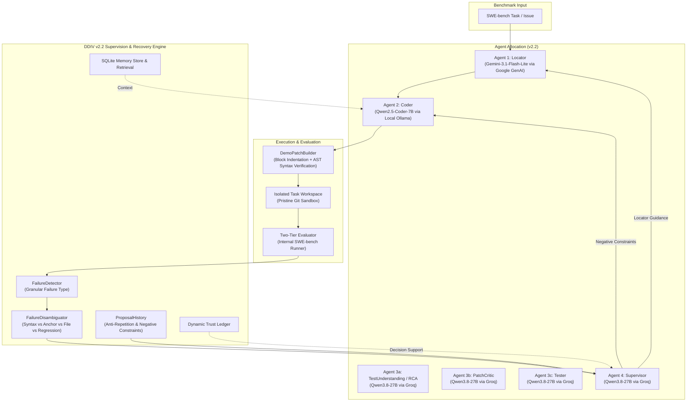

# DDIV: Detect → Diagnose → Intervene → Verify

**A Multi-Agent Software Repair Framework with Explicit Failure Diagnosis, Targeted Recovery, Persistent Execution Memory, Dynamic Trust Management, and Quota-Free Local Coder Inference.**

[](https://www.python.org/)
[](https://opensource.org/licenses/MIT)
[]()
[]()

---

## 1. Overview & Research Motivation

Autonomous Large Language Model (LLM) agents demonstrate substantial promise in software engineering benchmarks such as SWE-bench. However, conventional multi-agent repair workflows suffer from compounding misconceptions: an early fault localization mistake or a hallucinated API can propagate through downstream code generation and test stages, leading to wasted attempts or repetitive patch cycles.

**DDIV** investigates the hypothesis that a multi-agent repair workflow augmented with:
1. **Multi-Source Failure Detection** (deterministic static rules + model analysis)
2. **Explicit Failure Diagnosis** across a standardized 4-class taxonomy ($F1 - F4$)
3. **Targeted Closed-Loop Interventions** ($A1 - A4$) rather than blind retries
4. **Anti-Repetition Tracking** (`ProposalHistory`) generating hard negative prompt constraints
5. **Empirical Failure Disambiguation** (`FailureDisambiguator`) to prevent unhelpful blame shifting
6. **Persistent Execution Memory** (recording historical failure patterns and successful recoveries)
7. **Dynamic Trust Management** (evidence-based reliability tracking per agent)

achieves significantly higher resolution rates and repair efficiency than conventional baseline or blind-retry multi-agent systems operating with the **exact same underlying models and test budgets**.

---

## 2. DDIV v2.2 Architecture & Infrastructure

DDIV v2.2 introduces local Ollama integration for the Coder agent, eliminating cloud token quota bottlenecks while preserving fair multi-agent routing.



### Agent Roles & Model Routing

| Agent Role | Model Architecture | Provider / Runtime | Primary Responsibility | Output Schema |
| :--- | :--- | :--- | :--- | :--- |
| **Locator** | `gemini-3.1-flash-lite` | Google GenAI API | Fault localization in repo files | `relevant_files`, `relevant_symbols`, `reasoning_summary` |
| **Coder** | `qwen2.5-coder:7b` | Local Ollama (`:11434`) | Patch synthesis (modifications or unified diff) | `modifications`, `patch`, `modified_files` |
| **TestUnderstanding (RCA)** | `qwen/qwen3.8-27b` | Groq API | Root-cause analysis & behavioral contracts | `root_cause`, `behavioral_contract`, `required_change` |
| **PatchCritic** | `qwen/qwen3.8-27b` | Groq API | Non-blocking pre-test advisory | `approved`, `risk_level`, `reasoning` |
| **Tester** | `qwen/qwen3.8-27b` | Groq API | Test review & regression suspicion | `assessment`, `suspected_failures`, `recommended_tests` |
| **Supervisor** | `qwen/qwen3.8-27b` | Groq API | Closed-loop diagnosis & targeted recovery | `should_retry`, `detected_failure`, `recovery_strategy`, `avoid_previous_mistake` |

---

## 3. Key v2.2 Recovery Enhancements

### 3.1 Local Ollama Coder with Zero Cloud Fallback
- Local inference at `http://localhost:11434/api/generate` enables quota-free experimentation.
- **Strict isolation guarantee**: When `DDIV_CODER_PROVIDER=ollama`, connection or generation errors immediately halt the run with explicit error codes (`CODER_CONNECTION_REFUSED`, `CODER_TIMEOUT`, `CODER_MODEL_NOT_FOUND`). Under no circumstances is silent fallback to cloud APIs permitted.

### 3.2 Block-Aware Indentation Normalizer & AST Verification (`DemoPatchBuilder`)
- Patches built from structured `CodeModification` objects (`path`, `operation`, `anchor`, `code`, `reason`) automatically calculate indentation:
  - Inside function/class header blocks (`def ...:`, `class ...:`): indents inserted code to `anchor_indent + 4 spaces`.
  - Under existing statements: matches the statement's indentation level.
- Verifies Python AST syntax before emitting unified diffs.
- Safely resolves placeholder paths (e.g., `path/to/run.py` resolves if and only if `run.py` uniquely exists in the repository).

### 3.3 Anti-Repetition Recovery (`ProposalHistory`)
- Records normalized keys of all previous proposals per task.
- When an attempt fails, `ProposalHistory` synthesizes hard negative prompt constraints:
  ```
  CRITICAL DIRECTIVE: DO NOT REPEAT PREVIOUS FAILED PROPOSALS:
  - Attempt 1: Modified 'src/flask/blueprints.py' (op: replace) at anchor 'root_path=root_path,'. Result: [UNRESOLVED_ATTEMPT]. You MUST NOT generate this identical modification again.
  ```
- Injected directly into the next Coder prompt via `avoid_previous_mistake`.
- Detects circular repeat proposals and triggers `REPEATED_PATCH_CYCLE` recovery.

### 3.4 Failure Disambiguation & Accurate Reporting (`FailureDisambiguator`)
- Cleanly separates:
  - `SYNTAX_ERROR_INDENTATION`: Python AST syntax or indent failure.
  - `TARGET_FILE_NOT_FOUND`: Specified file absent from workspace.
  - `ANCHOR_NOT_FOUND` / `ANCHOR_AMBIGUOUS`: Anchor matching issues.
  - `REPEATED_PATCH_CYCLE`: Byte-for-byte or whitespace-equivalent proposal repetition.
  - `P2P_REGRESSION`: Existing passing tests broken by patch.
  - `F2P_FAILURE`: Reproduction tests not satisfied.
- **Reporting ground truth**: Distinguishes unexecuted tests after patch application failure from 0-test denominators, formatting results as `0/N (Not Run - Apply Failed)` instead of `0/0`.

---

## 4. Experimental Conditions (1:1 Controlled Evaluation)

DDIV enforces strict condition isolation across three standardized regimes:

1. **`BASELINE`** (`max_attempts = 1`):
   - Single-pass feedforward execution (`Locator` → `Coder` → `Tester` → `Verify`).
   - Supervisor, RCA, Critic, Memory, Trust, and Anti-Repetition: **DISABLED**.
   - Serves as the single-turn benchmark baseline.

2. **`RETRY_ONLY`** (`max_attempts = 3`):
   - Blind multi-attempt retry from a clean attempt state.
   - Workspaces cleanly reverted to pristine git base commit before each attempt.
   - Supervisor, Diagnosis, RCA, Memory, Trust, and Anti-Repetition: **DISABLED**.
   - Reruns the exact same repair workflow with identical budgets, testing whether extra attempts alone account for performance gains.

3. **`FULL_DDIV`** (`max_attempts = 3`):
   - Multi-attempt repair with full closed-loop supervision.
   - Supervisor, RCA, Critic, Memory, Trust, Anti-Repetition, and Failure Disambiguation: **ENABLED**.
   - Uses `V22SupervisedWorker` with guaranteed `try...finally` method restoration.

---

## 5. Repository Structure

```
DDIV/
├── agents/                     # [FROZEN v2.1] Core agent implementations
│   ├── base.py                 # Agent schemas, metadata, and telemetry
│   ├── locator.py              # Fault localization agent
│   ├── coder.py                # Unified diff & modification synthesis
│   ├── tester.py               # Test review agent
│   └── supervisor.py           # Closed-loop supervision agent
├── core/                       # Orchestration & execution framework
│   ├── conditions.py           # ExperimentCondition enum (BASELINE, RETRY_ONLY, FULL_DDIV)
│   ├── config.py               # Runtime configuration & provider routing
│   ├── experiment_orchestrator.py # Multi-condition orchestrator
│   ├── experiment_record.py    # Serializable experiment outcome records
│   └── experiment_worker.py    # Worker executing end-to-end task runs
├── evaluation/                 # [FROZEN v2.1] SWE-bench evaluation harness
│   ├── command_runner.py       # Subprocess runner with timeout management
│   ├── patch_builder.py        # Patch builder base contract
│   ├── patch_manager.py        # Git apply, revert, and validation
│   ├── swebench_loader.py      # SWE-bench Verified dataset loader
│   ├── swebench_runner.py      # Internal test runner & parser
│   └── workspace.py            # Isolated git workspace manager
├── memory/                     # [FROZEN v2.1] Execution memory & trust
│   ├── memory_store.py         # SQLite episodic memory store
│   ├── retrieval.py            # Evidence-based memory retriever
│   └── trust_ledger.py         # Dynamic trust score tracking
├── recovery/                   # [FROZEN v2.1] Failure detection & diagnosis
│   ├── failure_detector.py     # Deterministic & heuristic failure detectors
│   ├── diagnosis.py            # Failure diagnosis synthesizer
│   └── strategies.py           # Recovery action builders
├── models/                     # [FROZEN v2.1] Model provider abstractions
│   ├── base.py                 # Abstract ModelProvider interface
│   └── registry.py             # Model registry & provider lookup
├── scripts/                    # v2.2 Execution, verification & audit tools
│   ├── demo_patch_builder.py   # Block indentation & AST syntax validator
│   ├── launch_gate_check.py    # Pre-launch gate check with Ollama validation
│   ├── ollama_coder_adapter.py # Local Ollama provider with zero cloud fallback
│   ├── run_local_ollama_comparison.py # Formal 3-condition benchmark runner
│   ├── run_v2_2_dev_validation.py     # Isolated development validation runner
│   ├── v2_2_recovery_manager.py       # ProposalHistory, Disambiguator, V22SupervisedWorker
│   └── verify_and_preseed_workspaces.py # Disposable workspace checkout verifier
├── tests/                      # Automated test suites (100% passing)
│   ├── test_demo_patch_builder.py     # Indentation & syntax tests
│   ├── test_launch_safety.py          # Launch gate & orchestrator safety tests
│   ├── test_ollama_provider.py        # Ollama provider contract & isolation tests
│   └── test_v2_2_improvements.py      # Anti-repetition, disambiguation & worker tests
├── results/                    # Research results, audits & freeze manifests
│   └── v2_2_development/      # v2.2 Audit deliverables & verification records
│       ├── final_blockers.md
│       ├── final_execution_path_audit.md
│       ├── final_preflight.json
│       ├── final_test_report.md
│       ├── v2_2_freeze_manifest.json
│       └── workspace_preflight_verification.json
└── README.md
```

---

## 6. Installation & Environment Setup

### Prerequisites
- **OS**: Windows 11 / Linux / macOS
- **Python**: 3.10+ (tested on Python 3.11.9)
- **Git**: 2.40+ (Windows: `git config --global core.longpaths true`)
- **Ollama**: Installed and running (`ollama serve`)
- **Model**: `ollama pull qwen2.5-coder:7b`

### Setup
```bash
git clone https://github.com/devensonawane007/DDIV.git
cd DDIV

python -m venv .venv
# Windows:
.venv\Scripts\activate
# Linux/macOS:
source .venv/bin/activate

pip install -r requirements.txt
```

### Environment Configuration
Create a `.env` file in the repository root:
```env
DDIV_MODE=full_ddiv
DDIV_CODER_PROVIDER=ollama
OLLAMA_BASE_URL=http://localhost:11434
OLLAMA_MODEL=qwen2.5-coder:7b

# Supporting cloud agents (Groq)
GROQ_API_KEY=your_groq_api_key

# Fault localization (Google GenAI)
GEMINI_API_KEY=your_gemini_api_key
```

---

## 7. Verification & Pre-Launch Gate Checks

Before initiating any benchmark runs, execute the verified pre-flight checks:

### 1. Run All Automated Test Suites
```bash
python -m pytest tests/test_v2_2_improvements.py tests/test_launch_safety.py tests/test_ollama_provider.py tests/test_demo_patch_builder.py -v
```
*(All 32 test cases pass in ~160 seconds).*

### 2. Verify Disposable Workspaces Across All 20 Benchmark Tasks
```bash
python scripts/verify_and_preseed_workspaces.py
```
*(Verifies 20/20 repository checkouts at exact base commits in disposable sandboxes; dry-run validates 60 task-condition pairs with zero model invocations).*

### 3. Run Pre-Launch Gate Check for Batch N
```bash
python scripts/launch_gate_check.py --batch 1 --verified-groq-available 150000
```
*(Confirms checkpoint & manifest SHA-256 hashes, frozen directory cleanliness, Windows longpaths, dataset presence, Ollama connectivity, zero cloud fallback, and Groq token capacity).*

---

## 8. Audit Deliverables & Verification Records

The complete audit trail for DDIV v2.2 is available in `results/v2_2_development/`:

- [`final_blockers.md`](results/v2_2_development/final_blockers.md): Resolution report for the 4 identified launch blockers.
- [`final_execution_path_audit.md`](results/v2_2_development/final_execution_path_audit.md): End-to-end trace from benchmark runner to evaluation and report generation.
- [`final_preflight.json`](results/v2_2_development/final_preflight.json): Machine-readable preflight audit (`ready_for_launch: false`, awaiting explicit authorization).
- [`final_test_report.md`](results/v2_2_development/final_test_report.md): Consolidated test execution results across all 4 suites.
- [`v2_2_freeze_manifest.json`](results/v2_2_development/v2_2_freeze_manifest.json): Cryptographic SHA-256 manifest of all frozen and v2.2 components.
- [`workspace_preflight_verification.json`](results/v2_2_development/workspace_preflight_verification.json): Detailed base commit checkout records for all 20 benchmark tasks.

---

## 9. Current Status

The implementation, hardening, method-restoration safeguards, and preflight verifications are **complete**. The framework is in a frozen state awaiting explicit user approval before launching the 5-task pilot or full 20-task benchmark.
