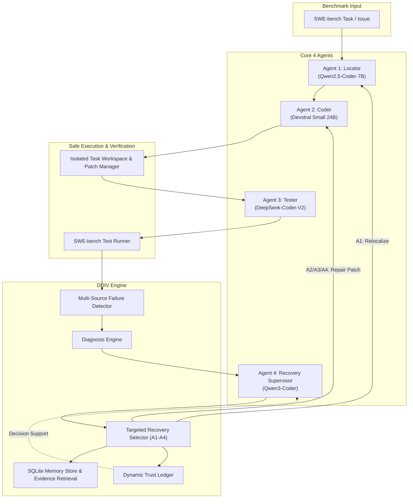

# DDIV: Detect → Diagnose → Intervene → Verify

**A Multi-Agent Software Repair Framework with Explicit Failure Diagnosis, Targeted Recovery, Memory, and Dynamic Trust Management.**

---

## 1. Overview & Research Motivation

Autonomous Large Language Model (LLM) agents have demonstrated substantial promise in software engineering benchmarks such as SWE-bench. However, conventional multi-agent workflows frequently suffer from cascading errors: an early fault localization mistake or a hallucinated API can propagate through downstream code generation and test stages, leading to wasted iterations, compounding misconceptions, or repetitive looping.

**DDIV** investigates the hypothesis that a multi-agent repair workflow augmented with:
1. **Multi-source Failure Detection** (deterministic rules + model analysis)
2. **Explicit Failure Diagnosis** across a standardized 4-class taxonomy ($F1 - F4$)
3. **Targeted Interventions** ($A1 - A4$) rather than random blind retries
4. **Persistent Execution Memory** (recording historical failure patterns and successful recoveries)
5. **Dynamic Trust Management** (evidence-based reliability tracking per agent)

achieves significantly higher resolution rates and repair efficiency than a conventional baseline multi-agent system operating with the **exact same underlying pretrained LLMs**.

---

## 2. Core Research Principle: Controlled Model Allocation

To ensure valid scientific attribution, **the baseline and DDIV experimental pipelines utilize the exact same underlying models**:

| Agent Role | Model Architecture | Primary Responsibility | Input Context | Output Schema |
| :--- | :--- | :--- | :--- | :--- |
| **Agent 1: Locator** | `Qwen2.5-Coder-7B-Instruct` | Fault localization | Issue, repo structure, memory | `relevant_files`, `relevant_symbols`, `reasoning_summary`, `confidence` |
| **Agent 2: Coder** | `Devstral Small 24B` | Patch synthesis (unified diff) | Issue, locator output, code, recovery directive | `patch`, `modified_files`, `reasoning_summary`, `confidence` |
| **Agent 3: Tester** | `DeepSeek-Coder-V2` | Test review & regression analysis | Issue, candidate patch, code, tests | `assessment`, `suspected_failures`, `recommended_tests`, `confidence` |
| **Agent 4: Supervisor** | `Qwen3-Coder` | Workflow supervision & recovery | Traces, test results, trust scores, memory | `should_retry`, `detected_failure`, `diagnosis`, `recovery_strategy`, `intervention_instructions` |

---

## 3. System Architecture



---

## 4. Failure Taxonomy & Targeted Interventions

DDIV defines an explicit, fixed four-class failure taxonomy ($F1 - F4$) coupled directly with targeted recovery strategies ($A1 - A4$):

### Failure Taxonomy
- **F1 — Localization Failure**: The system modified the wrong file, class, function, or symbol. Identified deterministically when modified files are disjoint from localized files or issue scope.
- **F2 — Code / Reasoning Failure**: The correct code area was targeted, but the patch contains algorithmic errors, hallucinated APIs, or misses edge cases. Identified when patch applies cleanly but tests fail with assertion errors or regressions.
- **F3 — Tool / Patch / Execution Failure**: Execution infrastructure or formatting failure. Identified when git patch fails validation, hunk headers are rejected, syntax errors occur, or commands time out.
- **F4 — Coordination / Strategy Failure**: The agents converge on an ineffective strategy, thrash, or repeatedly propose identical patches across attempts.

### Targeted Recovery Strategies
- **A1 — Localization Recovery** (for $F1$): Broaden search, inspect caller/callee trees and neighboring symbols; re-run Locator with explicit failure context.
- **A2 — Code / Reasoning Recovery** (for $F2$): Provide exact test assertion trace and failed lines to Coder; request alternative algorithmic design or edge-case handling.
- **A3 — Execution Recovery** (for $F3$): Clean unified diff headers, fix formatting, strip markdown wrappers, and re-attempt patch application.
- **A4 — Strategy / Coordination Recovery** (for $F4$): Ban previous patch proposals, inject prior failed attempts as anti-examples, reset reasoning paths, and consult memory.

---

## 5. Dynamic Trust Ledger

The Trust Ledger (`memory/trust_ledger.py`) maintains an auditable reliability score $T \in [0.0, 1.0]$ for each agent.

Initial default priors:
- **Locator**: $0.87$
- **Coder**: $0.74$
- **Tester**: $0.91$
- **Supervisor**: $0.84$

### Update Mechanism:
$$T_{next} = \text{clip}\left(T_{current} + \Delta_{success} \cdot w - \Delta_{failure} \cdot w,\; 0.0,\; 1.0\right)$$

- **Decision-Support Principle**: Trust scores inform supervisor prioritization and confidence weighting, but **objective test/harness results always take absolute precedence**. Trust never overrides empirical test failures.

---

## 6. Execution Modes & Comparative Experiment Conditions

DDIV supports rigorous comparative evaluation across three standardized conditions:

1. **`BASELINE`** (`max_attempts = 1`):
   - Single-pass feedforward execution (`Locator` → `Coder` → `Tester` → `Verify`).
   - Supervisor: DISABLED.
   - Memory: DISABLED.
   - Trust: DISABLED.
   - Represents standard single-turn LLM code repair baselines.

2. **`RETRY_ONLY`** (`max_attempts = 3`):
   - True blind multi-attempt retry condition from a clean attempt state.
   - Supervisor: DISABLED.
   - Failure Diagnosis ($F1 - F4$): DISABLED.
   - Targeted Interventions ($A1 - A4$): DISABLED.
   - Memory Store: DISABLED.
   - Dynamic Trust Ledger: DISABLED.
   - After a failed attempt, workspaces are cleanly reverted to base commit and the exact same repair workflow is rerun without supervisor feedback or memory guidance, subject to identical task, model, tool, token, temperature, and timeout budgets.

3. **`FULL_DDIV`** (`max_attempts = 3`):
   - Multi-attempt repair with full DDIV closed-loop supervision.
   - Supervisor: ENABLED.
   - Failure Diagnosis ($F1 - F4$): ENABLED.
   - Targeted Interventions ($A1 - A4$): ENABLED.
   - Memory Store: ENABLED (SQLite episodic store).
   - Dynamic Trust Ledger: ENABLED (dynamic reliability tracking).

---

## 7. Project Structure

```
DDIV/
├── agents/
│   ├── base.py            # Base agent with Pydantic schemas & telemetry
│   ├── locator.py         # Agent 1: Fault localization
│   ├── coder.py           # Agent 2: Unified diff synthesis
│   ├── tester.py          # Agent 3: Test review & regression analysis
│   └── supervisor.py      # Agent 4: Supervision, classification & recovery
├── models/
│   ├── base.py            # Abstract ModelProvider & config schemas
│   ├── providers.py       # OpenAI-compatible & deterministic Mock providers
│   └── registry.py        # Model registry & provider factory
├── core/
│   ├── config.py          # Environment settings & experiment flags
│   ├── state.py           # RunState and AttemptRecord serializable models
│   ├── events.py          # Event types for state transitions
│   └── orchestrator.py    # State machine managing Baseline & DDIV workflows
├── memory/
│   ├── schemas.py         # MemoryRecord and TrustEvent schemas
│   ├── memory_store.py    # SQLite database for execution experience
│   ├── retrieval.py       # Evidence-based query retriever
│   └── trust_ledger.py    # Dynamic trust score management
├── recovery/
│   ├── failure_detector.py # Deterministic & heuristic failure detectors
│   ├── diagnosis.py       # Synthesis of detector signals & LLM diagnosis
│   └── strategies.py      # A1, A2, A3, A4 recovery action builders
├── evaluation/
│   ├── workspace.py       # Safe, isolated task workspaces
│   ├── patch_manager.py   # Unified diff validation, apply & revert
│   ├── command_runner.py  # Subprocess runner with timeout capture
│   ├── swebench_loader.py # SWE-bench Verified dataset loader
│   ├── swebench_runner.py # Verification runner & test result parser
│   ├── benchmark.py       # Multi-task benchmark runner
│   └── metrics.py         # Statistical metrics accumulator
├── logging_system/
│   └── trace_logger.py    # Structured JSONL logger & terminal summaries
├── scripts/
│   ├── run_task.py        # CLI to execute a single task
│   ├── run_benchmark.py   # CLI to execute batch evaluations
│   └── analyze_results.py # CLI to parse traces and generate tables
├── tests/                 # Automated unit and integration test suite
├── .env.example           # Example environment configuration
├── requirements.txt       # Dependencies
└── pyproject.toml         # Package definition
```

---

## 8. Installation & Setup

### Prerequisites
- Python 3.10+
- Git

### Installation
```bash
git clone <repo-url>
cd DDIV
python -m venv .venv
# On Windows:
.venv\Scripts\activate
# On Linux/macOS:
source .venv/bin/activate

pip install -r requirements.txt
```

### Configuration
Copy `.env.example` to `.env`:
```bash
cp .env.example .env
```
Configure your model keys and API base URL in `.env`:
```env
DDIV_MODE=ddiv
PROVIDER_TYPE=openai_compatible
API_BASE_URL=https://api.together.xyz/v1
LOCATOR_API_KEY=your-api-key
CODER_API_KEY=your-api-key
TESTER_API_KEY=your-api-key
SUPERVISOR_API_KEY=your-api-key
```

---

## 9. Quickstart & CLI Usage

### Running Tests
The framework includes a comprehensive test suite (28 automated tests covering all agents, deterministic failure rules, patch management, trust updates, memory, and end-to-end recovery):
```bash
python -m unittest discover tests -v
```

### Running in Deterministic Mock Mode (Zero API Cost)
To verify the entire pipeline without API keys:
```bash
# Baseline Mode (1 attempt)
python -m scripts.run_task --task-id mock-task-1 --mode baseline

# DDIV Mode (Recovers from F2 on attempt 2)
python -m scripts.run_task --task-id mock-task-1 --mode ddiv
```

### Running Benchmark Batches
```bash
python -m scripts.run_benchmark --limit 1 --mode ddiv
```

### Analyzing Results
```bash
python -m scripts.analyze_results --logs-dir logs/runs
```

---

## 10. Research Limitations & Future Work

1. **Model API Constraints**: Live evaluations on SWE-bench Verified require valid provider endpoints with sufficient rate limits and context windows.
2. **Deterministic vs. LLM Tradeoffs**: Deterministic failure detection rules ($F3$ patch corruption, $F4$ patch looping) provide high-precision classification, while semantic logic errors ($F2$) rely partly on model reasoning.
3. **Environment Sandboxing**: Local workspaces use ephemeral directories and git worktrees. For full multi-language benchmarks, integrating Docker container execution remains recommended for non-Python dependencies.
