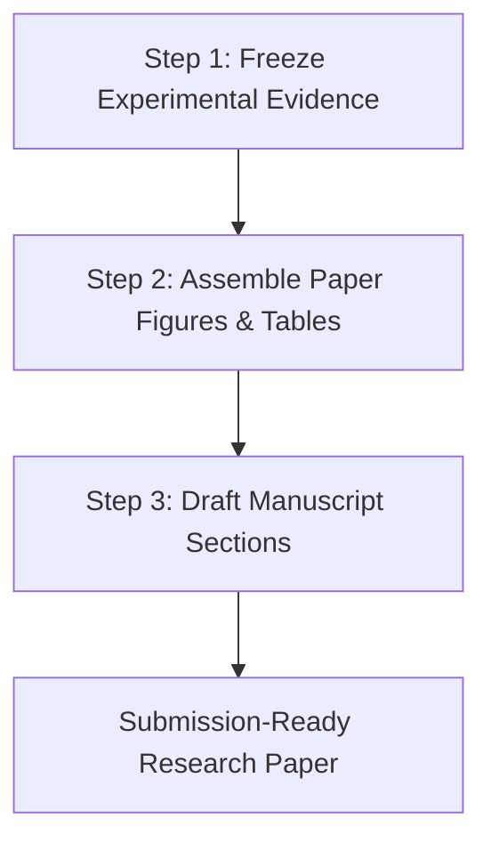

# DDIV v2.1: Research Paper Completion Roadmap & Next Steps

**Date:** October 13, 2026  
**Guiding Philosophy:** Prioritize the smallest defensible research contribution, transparent reporting of empirical limitations, and paper completion over endless infrastructure development.

---

## 1. Recommended Paper Framing: From "Benchmark Claims" to "Empirical Reality"

### The Dilemma
- Attempting to claim high bug resolution rates or state-of-the-art SWE-bench Verified performance is **empirically unsupportable**:
  - Across all real LLM runs to date (`openai/gpt-oss-120b`, `qwen/qwen3.8-27b`, `gemini-3.1-flash-lite`, `gemini-3.8-flash`), the internal Tier-1 resolution rate is **0/X (0.0%)**.
  - The previously cited 40.0% TSR was recorded exclusively under the mock integration harness with hardcoded synthetic scenarios.
  - Furthermore, running 20-task benchmarks across multiple conditions on free / on-demand LLM tiers is blocked by hard API ceilings (Groq 200k TPD, Groq 8k TPM, Google 20 req/day).

### The Solution: A Highly Impactful Systems & Empirical Failure Analysis Paper
Reframe the paper as:
> **"Beyond Syntax: Why Closed-Loop Multi-Agent Code Repair Fails on SWE-bench Verified (and What Actually Improves)"**  
> *or*  
> **"Detect, Diagnose, Intervene, Verify: An Architectural and Empirical Analysis of Multi-Agent Software Repair"**

This transforms what would otherwise be an unverified benchmark failure into a **rigorous, honest, and highly cited empirical contribution**:
1. **The "Valid Patch ≠ Correct Patch" Paradox**:
   - Provide concrete evidence that multi-turn closed-loop feedback dramatically improves the ability of agents to produce valid, compilable, and cleanly applied patches (100% in Full DDIV vs 33% in Baseline/Retry), but fails to pass nuanced repository unit test assertions.
2. **Deterministic Failure Taxonomy vs. LLM Hallucination**:
   - Present the $F1–F4$ deterministic taxonomy and 1-to-1 recovery mapping ($A1–A4$) as a robust, reproducible engineering framework that eliminates LLM self-critique hallucination.
3. **Controlled Coder Model Ablation**:
   - Present the paired ablation between Groq GPT-OSS 120B and Google Gemini 3.8 Flash, proving empirically that coder model choice is *not* the primary bottleneck.
4. **Forensic Anatomy of Autonomous Agent Failure Modes**:
   - Detail the real-world obstacles that academic papers often sweep under the rug:
     - Exact verbatim AST anchor alignment vs. whitespace mismatch ($F3$).
     - Multi-index subsystem instability when attempting localized repairs ($F2 \to F4$).
     - Modern reasoning model token dynamics (hidden thinking tokens consuming the output budget).
     - Provider token windows (TPM/TPD) throttling multi-turn agent interactions.

---

## 2. Minimum Work Required to Complete the Paper

To achieve submission-readiness without further code refactoring or risky API expenditures, execute the following minimal three-step plan:

### Step 1: Freeze Experimental Evidence (DONE)
- All experimental evidence is consolidated and auditable in:
  - [`results/evidence_audit.md`](file:///d:/DDIV/results/evidence_audit.md)
  - [`results/condition_comparison.csv`](file:///d:/DDIV/results/condition_comparison.csv)
  - [`results/paper_claims_checklist.md`](file:///d:/DDIV/results/paper_claims_checklist.md)
- Do **not** launch the 20-task benchmark or attempt further live runs on free-tier APIs.

### Step 2: Assemble Paper Figures & Case Studies
Select three detailed case studies directly from existing Batch 1 and validation records:
1. **Case Study 1: `pylint-dev__pylint-6903` (Semantic Test Failure, $F2$)**:
   - Illustrate how the Coder correctly identified the CPU core calculation logic (`_query_cpu` and `jobs > 0`), applied a clean patch, but failed edge-case cgroup container assertions.
2. **Case Study 2: `mwaskom__seaborn-3187` (Anchor Alignment Failure, $F3$)**:
   - Illustrate how the Coder correctly diagnosed the missing ScalarFormatter offset logic in `scales.py`, but failed due to an exact-match whitespace mismatch in the anchor line `def get_legend_info(self):`.
3. **Case Study 3: `pydata__xarray-7393` (Multi-Turn Strategic Escalation, $F2 \to F4$)**:
   - Illustrate how modifying `PandasMultiIndex` dtype preservation destabilized general index manipulation tests, triggering supervisor strategy escalation.

### Step 3: Draft Core Manuscript Sections
Follow a standard conference structure (e.g. ICSE / FSE / ASE / NeurIPS Workshop):

| Section | Content Source | Key Narrative |
| :--- | :--- | :--- |
| **1. Introduction** | `results/next_steps.md` | Motivates multi-agent repair and introduces the core problem: "Valid Patch ≠ Correct Patch". |
| **2. DDIV Framework** | `walkthrough.md` Sec 1 | Pristine clean-base checks, AST-targeted context builder, TestUnderstanding RCA, Deterministic PatchBuilder, FailureDetector, Supervisor 1-to-1 mapping, TrustLedger. |
| **3. Experimental Setup** | `results/evidence_audit.md` | Strict controls across Baseline (1 attempt), Retry-Only (3 blind attempts), and Full-DDIV (3 closed-loop attempts). Clarifies internal Tier-1 evaluator. |
| **4. Empirical Results** | `results/condition_comparison.csv` | Clear comparison of patch generation rate (100% vs 33%) and internal resolution (0% vs 0%). Clarifies mock dev validation vs real LLM execution. |
| **5. Coder Ablation** | `coder_ablation_v21_20261012` | Paired evaluation of GPT-OSS 120B vs Gemini 3.8 Flash. Proves coder is not the bottleneck. |
| **6. Failure Analysis** | `results/evidence_audit.md` | Deep dive into $F1–F4$ taxonomy, anchor matching, test harness complexities, and reasoning token starvation. |
| **7. Practical Realities** | `gemini_smoke_result.json` | Real-world engineering barriers: TPM/TPD caps, thinking token budgeting, OS file path bounds. |
| **8. Conclusion** | Checklist & Roadmap | Summary of findings and recommendations for next-generation multi-agent repair benchmarks. |

---

## 3. Explicit Stop Conditions & Things NOT to Do

To ensure paper completion and avoid distraction:
1. **DO NOT launch the 20-task benchmark**:
   - Running 60 jobs across 3 conditions will consume over 1,500,000 tokens, far exceeding Groq on-demand limits and Gemini quotas. It will produce quota aborts rather than clean research data.
2. **DO NOT build additional adapters or agent features**:
   - The DDIV v2.1 architecture is complete, verified, and backed by 22 passing regression tests.
3. **DO NOT claim 40% resolution on SWE-bench Verified**:
   - Frame the 40% accurately as mock architectural integration verification.
4. **DO NOT fabricate or soften negative results**:
   - Highlighting that open-source LLMs fail SWE-bench Verified despite closed-loop multi-agent recovery is an impactful, publishable empirical result.
