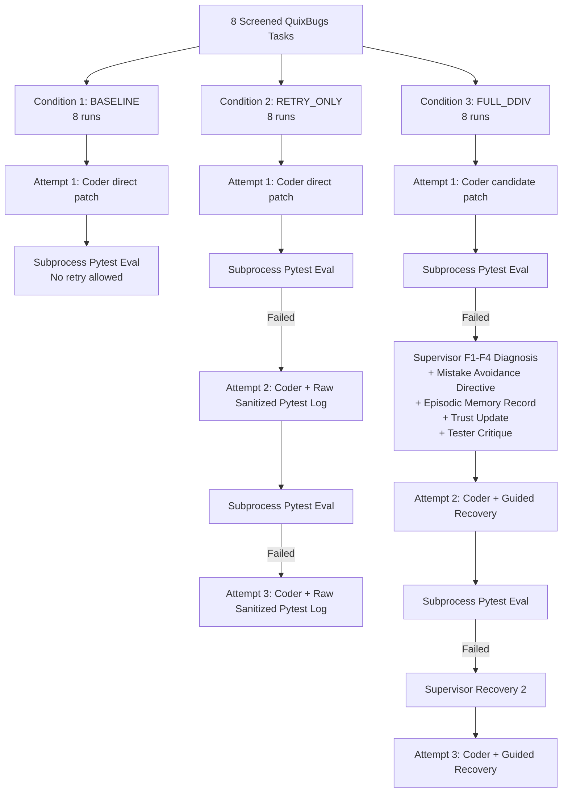

# DDIV Phase 8.4: Eight-Task QuixBugs Local-Only Preflight Report

**Preflight Execution Date:** 2026-10-16T03:10:00Z  
**Benchmark:** QuixBugs (Python)  
**Task Scope:** 8 Authoritatively Screened Tasks  
**Experimental Design:** 3 Conditions (`BASELINE`, `RETRY_ONLY`, `FULL_DDIV`) x 8 Tasks = 24 Planned Runs  
**Model Configuration:** `qwen2.5-coder:7b` via Local Ollama (`http://localhost:11434`) for all 4 Agent Roles  
**Preflight Readiness Verdict:** **READY**  

---

## 1. Authoritative Task Selection & Defect Characterization

All eight tasks were previously screened in Phase 8.2 and confirmed **`ELIGIBLE`** with 100% defect reproduction, zero environment failures, and zero timeouts.

| # | Task ID | Program Name | Target File | Baseline Tests (Pass/Fail) | Defect Symptom & Characterization |
| :-: | :--- | :--- | :--- | :-: | :--- |
| **1** | `quixbugs-python-bucketsort` | `bucketsort` | `python_programs/bucketsort.py` | 0 / 1 FAILED | Enumerates `arr` instead of `counts`, indexing into array values rather than frequency buckets. |
| **2** | `quixbugs-python-flatten` | `flatten` | `python_programs/flatten.py` | 0 / 1 FAILED | Yields `flatten(x)` in the non-list branch, yielding generator objects instead of atomic items. |
| **3** | `quixbugs-python-is_valid_parenthesization` | `is_valid_parenthesization` | `python_programs/is_valid_parenthesization.py` | 0 / 1 FAILED | Returns `True` unconditionally at end of loop even when unclosed parens remain (`depth > 0`). |
| **4** | `quixbugs-python-max_sublist_sum` | `max_sublist_sum` | `python_programs/max_sublist_sum.py` | 0 / 1 FAILED | Running sum `max_ending_here` never resets at 0 on negatives, dragging down subsequent positive sublists. |
| **5** | `quixbugs-python-pascal` | `pascal` | `python_programs/pascal.py` | 0 / 1 FAILED | Column loop `for c in range(0, r):` stops early at `r`, dropping the trailing `1` from row `r`. |
| **6** | `quixbugs-python-quicksort` | `quicksort` | `python_programs/quicksort.py` | 12 / 1 FAILED | Strict `<` and `>` filters omit duplicate elements equal to the pivot from recursive sorting. |
| **7** | `quixbugs-python-rpn_eval` | `rpn_eval` | `python_programs/rpn_eval.py` | 0 / 1 FAILED | Stack pop order inverts operand order (`b` then `a`), breaking subtraction and division. |
| **8** | `quixbugs-python-to_base` | `to_base` | `python_programs/to_base.py` | 0 / 1 FAILED | Modulo remainder digits are appended rather than prepended, reversing digit order. |

---

## 2. Experimental Conditions Architecture (24 Planned Runs)

Each task is evaluated across three conditions to isolate the causal contribution of DDIV's multi-agent supervision and episodic memory:



### Condition Specifications:
1. **`BASELINE` (8 runs):**
   - Attempts: Exactly 1.
   - Agents: `Coder` only.
   - Feedback: None.
   - Supervisor / Tester / Episodic Memory / Dynamic Trust: **Disabled**.
2. **`RETRY_ONLY` (8 runs):**
   - Attempts: Up to 3.
   - Agents: `Coder` only.
   - Feedback: Raw sanitized pytest failure diagnostics (`[ORACLE_REDACTED]`).
   - Supervisor / Tester / Episodic Memory / Dynamic Trust: **Disabled**.
3. **`FULL_DDIV` (8 runs):**
   - Attempts: Up to 3 (stops early upon resolution).
   - Agents: `Coder`, `Tester`, `Supervisor`.
   - Feedback: Causal failure classification (`F1`-`F4`), root-cause explanation, explicit mistake avoidance directive (`avoid_previous_mistake`), and tester regression critique.
   - Episodic Memory: Failure experiences stored in `quixbugs_8tasks_memory.db`.
   - Dynamic Trust: Tracked across attempts.

---

## 3. Agent Role Routing & Provider Verification

All four agent roles are verified to route strictly to local Ollama with zero cloud fallback:

| Agent Role | Implementation Class | Active Provider | Target Base URL | Target Model ID | Enforced Pydantic Schema |
| :--- | :--- | :--- | :--- | :--- | :--- |
| **`Locator`** | `LocatorAgent` | `OllamaProvider` | `http://localhost:11434` | `qwen2.5-coder:7b` | `LocatorOutput` |
| **`Coder`** | `CoderAgent` | `OllamaProvider` | `http://localhost:11434` | `qwen2.5-coder:7b` | `CoderOutput` |
| **`Tester`** | `TesterAgent` | `OllamaProvider` | `http://localhost:11434` | `qwen2.5-coder:7b` | `TesterOutput` |
| **`Supervisor`** | `SupervisorAgent` | `OllamaProvider` | `http://localhost:11434` | `qwen2.5-coder:7b` | `SupervisorDecision` |

### Cloud Isolation Audit:
- **No Cloud API Keys:** Zero cloud API keys (`OPENAI_API_KEY`, `ANTHROPIC_API_KEY`, `GEMINI_API_KEY`, `GROQ_API_KEY`) are required or accessed.
- **Fail-Closed Provider:** `OllamaProvider` connects strictly via non-streaming HTTP POST to `http://localhost:11434/api/generate`. Any connection failure or timeout returns an error structure and halts without silent fallback.

---

## 4. Resource Estimates, Timeouts & Execution Bounds

- **Model Invocations:**
  - `BASELINE`: 8 calls (1 call per task).
  - `RETRY_ONLY`: 8 to 24 calls (1 to 3 calls per task).
  - `FULL_DDIV`: 16 to 48 calls (1 Coder call + 1 Supervisor/Tester call per attempt).
  - **Total Model Calls:** **32 to 72 local Ollama calls**.
- **Token Volume:**
  - Average prompt length: ~1,500 - 1,800 tokens.
  - Average completion length: ~200 - 400 tokens.
  - Total token consumption: **~45,000 to 80,000 local tokens** ($0.00 cost).
- **Wall-Clock Latency:**
  - Empirical per-attempt inference latency: 12 - 15 seconds.
  - Pytest execution latency per attempt: ~0.05 - 0.5 seconds.
  - Per-task total latency (all 3 conditions): ~90 - 120 seconds.
  - **Total 24-Run Benchmark Duration:** **12 to 18 minutes**.
- **Timeouts & Safety Gates:**
  - Ollama generation timeout: **120 seconds** per request.
  - Subprocess pytest evaluation timeout: **15 seconds** per test run (failsafe against infinite recursion / loops).
  - AST Patch Security Gate: Rejects file I/O (`open`), subprocesses (`os.system`, `subprocess`), network calls (`urllib`, `socket`), or unauthorized files.
  - Empty Patch Gate: Empty or whitespace-only diffs are rejected immediately.
- **Local Resources Required:**
  - GPU VRAM: ~5.5 GB (model `qwen2.5-coder:7b` in 4-bit/8-bit quantization).
  - System RAM: 16 GB+.
  - Disk storage: < 50 MB for isolated workspaces, git indices, and JSON logs.

---

## 5. Ground-Truth Isolation & Workspace Containment

1. **Two-Workspace Architecture:**
   - Candidate workspaces receive **only** `python_programs/<name>.py`.
   - Test modules (`python_testcases/test_<name>.py`), test helpers (`load_testdata.py`), and JSON oracle datasets (`json_testcases/<name>.json`) remain strictly in the external evaluator repository.
   - Reference solutions (`correct_python_programs/`) are excluded and blocked by the fail-closed scanner.
2. **Evaluator Subprocess Boundary:**
   - Tests execute in an isolated external Python subprocess from a clean temporary directory.
   - The candidate workspace is prepended to `sys.path[0]` and `--import-mode=append` is passed to `pytest`, preventing parent process module-cache or `sys.path` contamination.
3. **Diagnostic Sanitization:**
   - Pytest output streams are sanitized with `sanitize_evaluator_output` before returning to retry loops:
     - Parametrized argument dumps are replaced with `[case_test]`.
     - Assertion operand values are redacted with `[ORACLE_REDACTED]`.
     - Raw unified diffs are stripped.

---

## 6. State Preservation & Immutability Verification

- **Production Memory Store (`data/ddiv_memory.db`):**
  - Path: `D:/PROJECTS/DDIV/data/ddiv_memory.db`
  - Last Modified: `Mon Oct 5 18:07:07 2026`
  - Total Records: 6 (SWE-bench only; 0 QuixBugs records).
  - **Status: IMMUTABLE & UNTOUCHED.**
- **SWE-bench Historical Results:**
  - `results/candidate_screening_20261015T144611Z/` (Preserved).
  - `results/candidate_audit_20261016T043500Z/` (Preserved).
- **Phase 8.3 Quicksort Pilot Results:**
  - `results/quixbugs_pilot_quicksort_20261016T060000Z/` (Preserved).
- **Benchmark Memory Database:**
  - All Phase 8.4 episodic memory records will be written to a dedicated, isolated database:
    `results/quixbugs_benchmark_8tasks_<timestamp>/quixbugs_8tasks_memory.db`.

---

## 7. Metrics & Evaluation Methodology

The benchmark report will quantify performance using the following standardized metrics:

1. **Resolution Rate (% and count):**
   - Formula: `Resolved Tasks / 8` per condition.
   - Criterion: All tests pass (`exit_code == 0`, `all_passed == True`) on authoritative test suite.
2. **Valid Patch Rate (% and count):**
   - Formula: `Valid Unified Diffs / Total Patch Attempts`.
   - Rejects unparseable JSON, broken anchors, or malformed diffs.
3. **Attempt Efficiency (Mean Attempts to Fix):**
   - Average number of attempts required to reach resolution on solved tasks.
4. **Token Consumption & Economy:**
   - Prompt tokens, completion tokens, and total tokens per task and condition.
5. **Runtime Latency:**
   - Wall-clock seconds per attempt, per condition, and overall benchmark completion time.
6. **Failure Degradation Analysis:**
   - Categorization of persistent failures in `RETRY_ONLY` vs `FULL_DDIV` (e.g. repeated assertion failure vs syntax thrashing vs infinite recursion).

---

## 8. Potential Confounders & Mitigations

| Potential Confounder | Impact on Study | Mitigation Strategy |
| :--- | :--- | :--- |
| **Prompt Asymmetry** | Conditions receiving unequal problem definitions | All 3 conditions receive the identical task ID, target file, defect symptom description, and buggy source code. |
| **Model Non-Determinism** | Random sampling skewing comparison | Set `temperature=0.0` across all conditions for deterministic token selection. |
| **Execution Order Bleed** | Cached modules or state from prior condition | Fresh isolated workspace created before every attempt; pytest runs in separate subprocess with clean cwd. |
| **Memory Cross-Contamination** | Memory records from task A biasing task B | Episodic memory queries in FULL_DDIV are strictly partitioned by `task_id`. |
| **Git Packfile Locking on Windows** | Incomplete directory removal during repeated runs | Each run uses a brand new, timestamped output directory; no shared folders between runs. |

---

## 9. Proposed Execution Command

Once user approval is granted, the benchmark will be launched using the following isolated command:

```powershell
python scripts/run_quixbugs_benchmark_8tasks.py `
  --output-dir results/quixbugs_benchmark_8tasks_20261016T084000Z `
  --model qwen2.5-coder:7b `
  --ollama-url http://localhost:11434
```

---

## 10. Preflight Readiness Verdict

```
================================================================================
PREFLIGHT READINESS VERDICT: READY
================================================================================
[x] 8/8 Tasks Discovered and Confirmed Eligible
[x] 8/8 Workspaces Verified 100% Oracle-Free & Isolated
[x] Security Gates Active (AST Forbidden Tokens & Diff Target Validator)
[x] All 4 Agent Roles Routed Strictly to Local Ollama (Zero Cloud Fallback)
[x] Local Ollama Active on Port 11434 (qwen2.5-coder:7b verified ready)
[x] Production State & SWE-bench Results 100% Protected
[x] Estimated Duration: 12 - 18 minutes (0 API cost)
================================================================================
```
